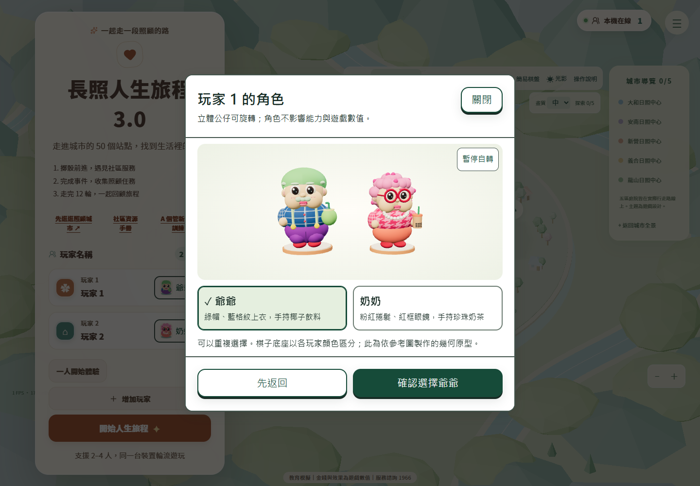

# 爺爺／奶奶 3D 角色實作交付

本次在既有專案內加入真正立體的 Three.js 幾何角色，沒有使用參考圖片作為 3D 棋子。未增加依賴，未加入伺服器或多人同步，未執行發布。

## 使用與整合

開始畫面每位玩家名稱旁有角色按鈕。開啟後可看兩位角色的 3D 預覽、拖曳旋轉、點選模型或角色卡，並確認選擇。預覽緩慢自轉，可暫停；減少動畫模式下不自轉。取消保留原選擇，確認先更新開始畫面的設定，開始遊戲時才透過原有 START_GAME 操作存入 Zustand 對應的 `players[].characterId`。

保留一人體驗及 2–4 人同裝置模式。可重複選角，使用玩家識別色底座、不同站位及原有玩家編號區分。HUD 肖像與 2D 棋盤也會跟隨角色選擇。無 WebGL 時，選角改用可操作的 SVG 預覽，遊戲使用既有 2D 棋盤；這些平面肖像只用於 UI 與明確的 2D 備援。



其他驗證截圖：[手機選角](artifacts/characters-preview-mobile.png)、[320px 選角](artifacts/characters-picker-320.png)、[背面](artifacts/characters-preview-back.png)、[城市棋子](artifacts/characters-city-closeup.png)、[2D 備援](artifacts/characters-city-2d.png)。

## 角色與資源架構

- `createCharacterModel` 提供共同的 `root / update / dispose` 介面。原點位於底座底部，靜態總高度 1.12 世界單位，前方為 +Z。
- 奶奶包含粉紅捲髮與深粉圓點、紅色圓框眼鏡、立體眼睛與臉頰、嘴唇、珍珠項鍊、粉紅花紋上衣、珊瑚下半身、紅鞋及珍珠奶茶。
- 爺爺包含綠帽、薄荷綠頭髮／眉毛／鬍鬚、立體五官、藍格紋上衣、淺綠吊帶與黃鈕扣、紫色褲子、紅鞋及椰子飲料。
- 頭部、雙臂、眼睛及配件以獨立群組建構；同一可動群組內的靜態零件使用 InstancedMesh 合批。依畫質共用幾何、柔和 PBR 材質及程序化服裝貼圖，引用計數歸零才釋放。
- 使用柔和照明及共用漸層接觸陰影，只有主要體積投射陰影。低畫質降低幾何細分，預覽 DPR 上限 1.5；不在每幀建立 Geometry、Material、Texture 或 renderer。
- `actor.ts` 只接收邏輯位置、動畫位置、回合／擲骰階段及座標轉換函式，輸出視覺位置與動作。主城市 Three.js 與原有 R3F 棋盤共用此控制器，不依賴特定 Store 或棋盤座標配置。

## 動畫參數

以下振幅是原型建模空間參數，最後隨模型統一縮放至 1.12 高度；不影響實際棋盤位置。

| 動作 | 參數與行為 |
| --- | --- |
| 待機 | 上下振幅 0.045、左右搖擺 0.025 弧度 |
| 眨眼 | 約每 4.6 秒一次，歷時 0.14 秒 |
| 蓄力 | 下壓係數 0.06，沿用既有擲骰階段 |
| 揭曉歡呼 | 約 0.45 秒彈跳，振幅 0.25，手臂抬起 |
| 行走 | 振幅 0.13，沿既有逐格動畫位置移動 |
| 抵達 | 約 0.32 秒落地彈跳，振幅 0.13 |
| 轉向／位移 | 指數平滑係數分別為 11／15，最短角度轉向 |
| 預覽 | 每秒自轉 0.22 弧度，可暫停及拖曳 |

動畫以 delta time 更新，每次 delta 上限 0.1 秒。減少動畫模式停用浮動、搖擺、眨眼與預覽自轉，直接呈現正確停靠位置。跳過移動仍由既有控制器完成權威操作，角色只讀取最終結果。

## 原有規則與存檔保護

50 格、五中心、骰子取樣、移動格數、事件、金錢、健康、壓力、輪替及勝負規則均沿用既有系統。角色模型不擲骰、不寫入數值、不觸發事件。

START_GAME 只新增可選的角色 ID 清單，長度與合法值均經純規則驗證。存檔 v3 新增可選角色欄位，保持舊版相容；v1／v2／v3 缺少角色的存檔，依玩家順序補上爺爺／奶奶交替預設。既有 40→50 格遷移照常執行，不因角色選擇改動位置或金錢。未知角色 ID 視為無效資料，由既有儲存層保留原始內容並阻止覆寫，避免靜默損毀。

## 未來替換 GLB

將正式模型放入 `public/models/`，在 `src/components/Characters/model.ts` 改對應設定，例如：

```ts
grandpa: {
  kind: 'gltf',
  url: import.meta.env.BASE_URL + 'models/grandpa.glb',
  rotationY: 0,
}
```

`rotationY` 用來修正資產原始朝向。載入器依 URL 快取、複製骨架，自動將高度與落地原點統一，保留玩家色底座及穩定外層群組；載入中或失敗時繼續使用幾何原型。最後一個使用者離開才釋放共享模型資源。

可辨識包含 idle、walk／run、charge、cheer／jump／wave、land 的動畫名稱；缺少對應片段時使用簡化程序動畫。沒有提供正式 GLB，因此已驗證的是記憶體測試資產的快取、複製、釋放與失敗備援；仍須用正式資產確認朝向、材質、骨架與動畫。尚未配置 Draco／KTX2 解碼器。

## 新增及修改檔案

| 狀態 | 檔案 | 用途 |
| --- | --- | --- |
| 新增 | `src/game/characters.ts` | 角色 ID、名稱、預設與驗證 |
| 新增 | `src/components/Characters/types.ts` | 模型與動畫共用介面 |
| 新增 | `src/components/Characters/resources.ts` | 幾何、材質、貼圖共享及釋放 |
| 新增 | `src/components/Characters/procedural.ts` | 爺爺／奶奶立體原型與動畫 |
| 新增 | `src/components/Characters/model.ts` | 可替換模型入口 |
| 新增 | `src/components/Characters/gltfModel.ts` | GLB 快取、骨架複製、動畫及正規化 |
| 新增 | `src/components/Characters/actor.ts` | 與規則分離的位移／朝向控制 |
| 新增 | `src/components/Characters/CharacterPreview.tsx` | 共用 renderer 的互動預覽 |
| 新增 | `src/components/Characters/CharacterPicker.tsx` | 可確認／取消的選角彈窗 |
| 新增 | `src/components/Characters/CharacterPortrait.tsx` | UI／2D 備援肖像 |
| 新增 | `src/characters.css` | 響應式選角介面 |
| 修改 | `src/main.tsx` | 引入角色樣式 |
| 修改 | `src/game/types.ts` | 玩家可選角色欄位 |
| 修改 | `src/game/rules/model.ts`、`src/game/rules/engine.ts` | 開始遊戲角色驗證與預設 |
| 修改 | `src/game/session/LocalGameSession.ts` | 既有操作通道接收角色設定 |
| 修改 | `src/game/store/createGameClient.ts` | Zustand 開始遊戲介面 |
| 修改 | `src/game/storage/saveCodec.ts` | 角色存檔相容與驗證 |
| 修改 | `src/components/UI/SetupScreen.tsx` | 每位玩家選角 |
| 修改 | `src/components/UI/HUD.tsx` | 角色肖像 |
| 修改 | `src/components/UI/CityMap.tsx` | 2D 角色棋子 |
| 修改 | `src/components/District/gamePieces.ts`、`src/components/District/CareIsland.tsx` | 城市角色與動畫整合 |
| 修改 | `src/components/Three/GameBoard3D.tsx` | 原有 R3F 棋盤角色整合 |
| 新增 | `scripts/test-characters.mjs` | 幾何／動畫／規則／存檔／GLB 介面測試 |
| 修改 | `scripts/test-game.mjs`、`scripts/test-browser.mjs` | 納入測試及新增瀏覽器驗收 |
| 修改 | `package.json` | 角色專項測試命令，未新增套件 |
| 新增／修改 | 本文件、`README.md` | 使用與交付說明 |

## 已執行驗證

| 檢查 | 結果 |
| --- | --- |
| `npm.cmd test` | 通過既有教育、棋盤、純規則、Session、存檔、擲骰，以及新增角色測試 |
| `npm.cmd run lint` | 結束碼 0；8 項既有警告，新增角色模組無警告 |
| `npm.cmd run build` | TypeScript 與 Vite 正式建置通過；保留 Three.js 大於 500KB 的分塊提示 |
| `node scripts/test-deploy.mjs` | 根目錄與 `/lohas_islands/` 的 HTML／CSS／JS／圖示資源路徑通過 |
| `node scripts/test-browser.mjs` | 完整既有遊戲回歸通過：城市、鏡頭、畫質、四人、擲骰／跳過、循環、存檔遷移、教育及 2D 備援 |
| `node scripts/test-browser.mjs --characters` | 桌面／390px／320px 選角、實際模型點選、自轉暫停、重複角色、四人識別、實際擲骰移動、存讀檔、舊存檔、減少動畫及 WebGL 失敗備援通過；未發現執行錯誤或資源 404 |

角色單元測試也驗證所有角色／畫質的立體包圍盒、必要配件、共享資源及最後釋放、動畫與眨眼、跨 49→0、跳過、舊存檔與非法角色資料保護。可另外執行 `npm.cmd run test:characters` 及 `npm.cmd run test:characters:browser`。

桌面 Headless Chrome 156／RTX 4060 的短時間抽樣，中／高畫質約 59.3–60 FPS；低畫質限制為 30 FPS。390px 手機視窗在同一桌面設備上測得 30 FPS。詳見 `artifacts/performance.json`，不能據此宣稱實體手機也達標。

## 差異與後續工作

這是可運作的程序化 Low-poly 公仔原型，並非參考圖的精細雕刻重製。已參考正面、側面與背面配置，但臉部比例、捲髮形狀、手指、衣服褶皺、飲料透明感與細部曲面均簡化；奶奶千鳥格為程序化近似花紋，無法與參考圖逐點一致。

後續可用正式雕塑／烘焙 GLB 提升外觀並減少零件批次，補充正式骨架動畫、壓縮貼圖與實體 iOS／Android 效能測試。現有測試涵蓋桌面瀏覽器中的手機尺寸，不等同實體手機驗收。完整測試主要針對目前主城市入口；舊 R3F 棋盤保留並通過型別建置，共用 actor 已有單元測試，但目前 UI 未提供此舊入口的完整瀏覽器流程。
