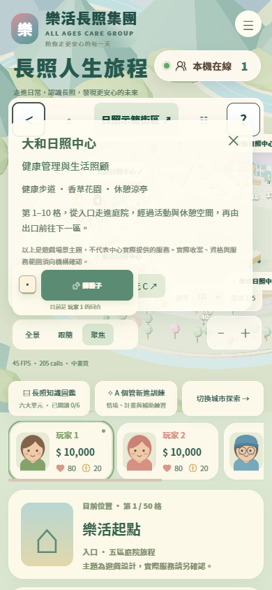
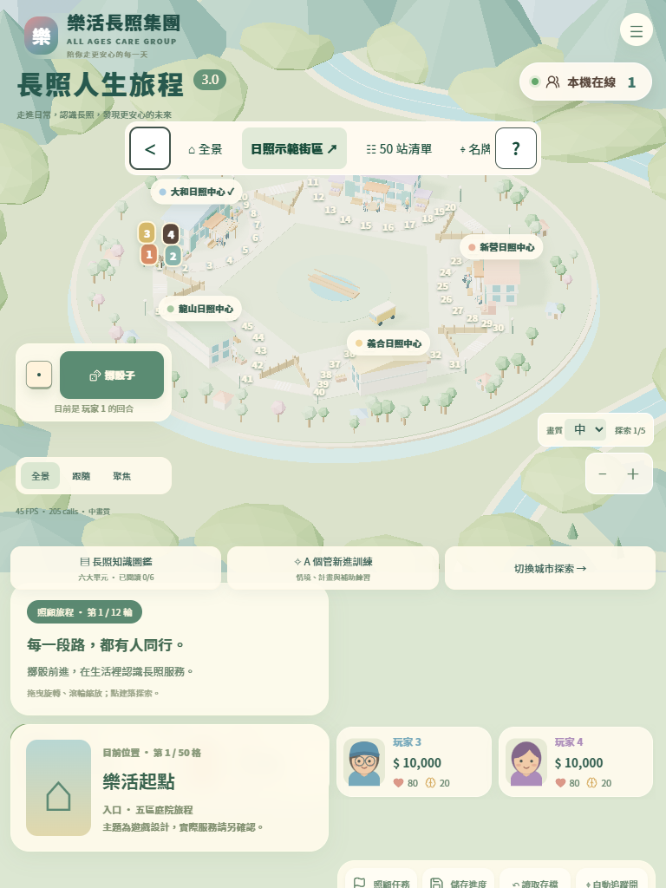

# 樂活之島｜整體 UI 視覺檢視

檢視日期：2026-10-30（台灣時間）。檢視對象：[正式網站](https://wowamin.github.io/lohas_islands/)。本次為檢視與分析，未修改或發布產品畫面。

## 整體判斷

奶油白、鼠尾草綠、圓角卡片、人物插畫與 Low-poly 城市已形成一致的療癒風格，值得保留。現在主要問題是「畫面各自看起來柔和，但整合後的層級、字級與版面約束不一致」，尚未完整達成先前設定的高齡友善規格。

應先修正遮擋與誤觸風險，再統一文字、按鈕與資訊層級。持續將全站字級乘上百分比，無法解決不同媒體規則仍把手機文字壓到 9–14px 的問題。

## 檢視範圍與證據

- 實際瀏覽正式站，收集 31 個畫面與計算後樣式：1440×900、1366×768、768×1024、390×844、320×740。
- 包含開始設定、四人遊戲、手機捲動、日夜、工具列、中心介紹、資源手冊、學習圖鑑、情境訓練、試算、服務碼、骰子設定、單一／多選事件、選擇後回饋、最終結算、2D 備援。
- 檢查文字大小、按鈕實際尺寸、區塊邊界、遮擋處的 elementFromPoint 命中結果；不僅檢查是否出現水平捲軸。
- 多選事件與最終結算使用獨立測試瀏覽器的本機存檔定位，不代表自然完成 12 輪；沒有更動使用者日常存檔或遠端資料。
- 主要檢視版本資源：`index-DumfuBm6.js`、`index-BCeSv64j.css`。截圖與原始量測位於 `artifacts/ui-review/`。
- 兩次檢視均未觀察到 JavaScript 執行例外或 HTTP 失敗回應；這不代表視覺與可操作性皆正常。

## 優先修正清單

P0 表示遮擋操作、可能誤觸其他功能；P1 表示主要閱讀／發現性問題；P2 表示一致性與美術精修。

| 優先 | 問題與實測證據 | 建議處理 |
| --- | --- | --- |
| P0 | 390px 中心介紹的「日照資源介紹」「學習單元」按鈕被擲骰控制蓋住。兩個按鈕中心點皆命中 `.dice-button`。 | 中心介紹改放在統一的 Modal／Drawer 層；開啟時阻擋背景操作，保留原回合。不要只調內層 z-index。 |
| P0 | 768px 平板版中，玩家 1、2 卡片與「目前位置」卡片占同一區域；姓名中心點命中 `.journey-footer`。 | 平板獨立使用明確 Grid areas，清除手機／桌面遺留的 grid-row、position 覆寫，讓玩家區與位置區各占一列。 |
| P1 | 320px 的在線徽章位於 x151–304、y72–116，主標題位於 x19–261、y80–120，明確重疊；1366px 也遮住玩家 4 姓名右側。 | 徽章移入系統選單，或在頁首保留獨立欄位。它不應與遊戲標題或玩家資訊競爭位置。 |
| P1 | 1440×900 首頁設定卡高約 953px，起點 y=-26，頂端被裁切；390×844 主要開始按鈕起點 y857，在首屏之外。 | 開始頁用正常文件流及可捲動容器，避免過高卡片仍垂直置中；把「一人開始／多人開始」提到更前面。 |
| P1 | 手機副標 9.93px、教育說明 8.57px、擲骰按鈕文字 11.55px、學習正文 14.34px。 | 實際元件套用語意字級：次要16、正文18–20、按鈕20–24、主要數值28以上；清理各斷點的 px 覆寫。 |
| P1 | 擲骰按鈕文字／背景對比約 3.67:1，普通小字未達 AA 的 4.5:1，也未達專案7:1目標。 | 將主要按鈕綠色加深，採深綠白字；讓背景插畫維持柔和，文字與操作採更深色。 |
| P1 | 320px 教育入口最下緣 y617，玩家卡姓名起點 y614，入口已與玩家區接觸／重疊。 | 教育入口回到版面流，用 gap 推開後續內容；不要只靠 top 與百分比 margin 補位置。 |
| P1 | 手機擲骰44px高、鏡頭按鈕約45×31px、學習關閉鍵40×40px、中心關閉鍵37×38px。 | 普通操作至少48×48，擲骰等主操作至少56px高；同步調整容器，避免放大後再遮住別區。 |
| P2 | 地圖非常淡，白色棋格編號與淺色道路分離不足；外圍山景面積大，與城市爭奪注意。 | 降低背景存在感，提高棋盤道路與當前位置對比；只突出目前玩家、落點與選取中心，保留其他數字的輔助層級。 |
| P2 | 「遊戲、城市探索、簡易棋盤、日照示範街區、專業訓練」同時露出，首次使用需要理解過多模式。 | 首次入口以「玩遊戲／逛城市／學知識」分組；專業訓練與進階設定保留於次層，不更動既有功能。 |

### 兩個已確認的遮擋

**中心面板：** 兩顆教育按鈕分別約在 `(31,392,105,34)`、`(144,392,92,34)`；中心點上方實際是擲骰按鈕。有誤觸擲骰的風險。

**平板玩家區：** 玩家卡 1、2 在 y838–919；位置卡在 x12–379、y835–982，範圍重疊。這與手機橫向玩家清單「可滑動看到其他玩家」不同，屬於真正遮擋。

## 各模組評估

### 開始頁

優點：有步驟說明、名稱設定與單人體驗，色彩一致，主要開始按鈕容易辨識。

問題：開始卡片過高；桌面版本把「3.0」拆成獨立大行，佔用過多高度。三個文字入口容易斷成多行；單人按鈕可見、多人開始卻在手機首屏下方，可能讓民眾誤以為必須先完成很多設定。

建議：先呈現任務與兩個明確入口「一人開始」「多人同玩」，再展開多人名稱設定。探索與手冊放在次要區；將專業訓練與民眾體驗分清楚。保留既有功能，改善排序即可。

證據：[桌面開始頁](artifacts/ui-review/01-desktop-setup.png)、[手機開始頁](artifacts/ui-review/02-mobile-setup.png)、[手機下半部](artifacts/ui-review/03-mobile-setup-bottom.png)。

### 遊戲主畫面與城市

優點：五中心分區與人物視覺明確；城市可作為品牌記憶點。手機擲骰已在左下，操作比將按鈕放到頁底更直接。

問題：左右側與底部同時配置多個浮動區塊；品牌、在線徽章、玩家卡、工具列、導覽、教育入口與鏡頭都在爭奪注意。手機四人清單需要橫滑，當前回合玩家可能不在可視區。健康與壓力主要靠小圖示與數字傳達，第一次玩的長輩不一定知道其含意。

建議：主畫面先固定三件事「輪到誰／目前位置／擲骰」。當前玩家置前或切回合時自動捲入可視區，另提供所有玩家清單。金錢、健康、壓力加上可見文字標籤與足夠大的數值。FPS／calls 診斷資訊移至進階設定。

背景維持 Low-poly 與粉彩，但將山景降為第二層；用更深的道路邊界、當前玩家描邊與選取標記提升辨識。地圖 50 個標記不宜全部擴成大按鈕，應搭配等價的大尺寸站點清單／中心入口。

證據：[桌面](artifacts/ui-review/05-desktop-game.png)、[筆電](artifacts/ui-review/06-laptop-game.png)、[手機](artifacts/ui-review/07-mobile-game.png)、[小手機](artifacts/ui-review/09-small-mobile-game.png)。

### 手機工具列

已改善：正式站現在是單列，左側收合、右側問號固定；問號沒有再掉到下一排。按鈕熱區也比先前完整。

後續：中間功能需要左右滑動，但看不出尚有更多項目；「日照示範街區」占很大面積且容易被當成主要操作。建議增加滑動提示或明確「更多」，並讓「目前模式」與「切換到其他模式」用不同視覺表達。保留收合狀態與夜間設定，避免展開後重新設定。

證據：[正式站單列工具列](artifacts/ui-review/07-mobile-game.png)、[收合](artifacts/ui-review/12-mobile-toolbar-collapsed.png)。

### 事件卡與結果揭曉

優點：這是目前層級較清楚的模組。情境、選項、結果分階段；選擇前沒有增減徽章，按下後才顯示實際變化與0變動，符合學習目的。選項與繼續按鈕面積足夠。

問題：情境正文約17.65px、說明12.85px、增減徽章14.7px，還未完全達到高齡規格。上方裝飾插畫占較多高度；長情境或文字放大時，選項需要較多捲動才能找到。

建議：保持目前流程；縮短裝飾區，正文20px，結果徽章至少18px；用「本次變化」配合文字，讓壓力下降是好結果更直覺。長內容讓正文區捲動，關鍵操作保持容易找到，不改動事件效果。

證據：[多選事件](artifacts/ui-review/27-mobile-event-choice.png)、[結果揭曉](artifacts/ui-review/28-mobile-event-choice-result.png)、[單一事件回饋](artifacts/ui-review/21-mobile-event-after.png)。

### 教育圖鑑、訓練與試算

優點：內容分類完整、學習與遊戲勝負分開、表單有標籤，手冊與教育範圍說明保留。

問題：手機上標頭、進度、五個分頁及六個模組選項先占去大量高度，正文從約 y619 才開始；真正閱讀區偏小。課文只有約14.34px，來源與頁尾約10–12px。右側分頁需橫滑才可見。40px關閉鍵也較小。

建議：閱讀時收合模組總覽，只保留「目前單元／切換單元」；固定閱讀區與操作區，減少一層導航。正文18–20px、來源16px，選取狀態除填色外加入文字／勾選。試算結果提供清楚的「查看結果」動作，避免使用者只看到很多欄位而不知道何時結束。

證據：[圖鑑](artifacts/ui-review/13-mobile-learning.png)、[試算](artifacts/ui-review/14-mobile-calculator.png)、[服務碼](artifacts/ui-review/15-mobile-services.png)、[訓練](artifacts/ui-review/16-mobile-training.png)。

### 資源手冊與設定面板

資源手冊的純色襯底、正文對比與段落節奏比較成熟，正文配色約8.57:1，可作其他面板的基準；但來源說明12.6px、關閉鍵44px，仍可向專案16px／48px目標統一。

骰子設定使用高對比白底、18px選項文字、48px標籤，視覺明顯比地圖周邊小字容易閱讀。應將這套規範推廣到現有遊戲，而不只保留在設定／示範頁。

證據：[資源手冊](artifacts/ui-review/18-mobile-resource-handbook.png)、[骰子設定](artifacts/ui-review/19-mobile-dice-settings.png)。

### 夜間與 2D 備援

夜間的品牌、標題與副標已切成白字，這點正常。城市棋格在夜間更容易與背景區分，但一些診斷小字仍維持深綠色，幾乎看不見；夜間配色應依「背景／面板／文字／邊框」整套管理。

2D 備援有完整棋盤與操作，值得保留。其提示是工程語彙「WebGL 不可用」，可改為民眾看得懂的「已使用簡易地圖，仍可正常遊玩」。2D 和 3D 的中心、當前位置與選取標記應共用辨識方式。

證據：[夜間](artifacts/ui-review/11-mobile-night.png)、[2D備援](artifacts/ui-review/24-mobile-2d-fallback.png)。

### 最終結算

排名與照顧足跡的結構清楚，能延續教育目的；但主要分數約19.95px，仍小於專案的28px強調數值目標。長足跡會把「再玩一次」推到面板底部，應提供容易找到的完成／再玩入口。彩紙動畫應短暫，避免持續蓋住數值；系統減少動態時保持關閉。

證據：[桌面結算](artifacts/ui-review/29-desktop-final-results.png)、[手機結算](artifacts/ui-review/30-mobile-final-results.png)。

## 字級與觸控量測摘錄

| 元件，手機390px | 實際字級／尺寸 | 專案建議 |
| --- | --- | --- |
| 主標題 | 30.45px | 可保留，先處理徽章遮擋 |
| 主標題副文 | 9.93px | 至少16px |
| 擲骰文字／按鈕高 | 11.55px／44px | 20px以上／56px以上 |
| 教育入口標題／輔助文 | 10.5px／8.57px | 18–20px／至少16px |
| 金錢／健康壓力 | 13.65px／10.5px | 主要數值28px左右，輔助至少16px |
| 鏡頭模式按鈕 | 約45×31px | 至少48×48px |
| 存檔等次要操作 | 約83×37px | 高至少48px |
| 學習正文／來源註記 | 14.34px／12.13px | 18–20px／至少16px |
| 學習關閉鍵 | 40×40px | 至少48×48px |
| 中心面板關閉鍵 | 37×38px | 至少48×48px |
| 資源手冊正文 | 17.65px | 可統一18–20px |
| 最終分數 | 19.95px | 至少28px |

## 對比量測摘錄

以下使用實際 CSS 指定的文字與不透明背景計算，不是螢幕截圖取樣；半透明襯底與3D背景不能只用單一固定色判定。

| 色組 | 約略對比 | 判斷 |
| --- | --- | --- |
| 擲骰按鈕：奶油白字／綠底 | 3.67:1 | 未達普通文字AA 4.5，更未達專案7:1 |
| 事件正文：褐灰字／奶油底 | 5.09:1 | 達AA普通文字，未達7:1目標 |
| 首頁開始按鈕：白字／橘褐底 | 4.98:1 | 達AA普通文字，未達7:1目標 |
| 存檔等操作：灰綠字／奶油底 | 3.98:1 | 未達普通文字AA 4.5 |
| 資源手冊正文 | 8.57:1 | 此色組達7:1 |
| 骰子設定正文 | 14.73:1 | 此色組達7:1 |

先前專案採「所有文字7:1、按鈕48px以上」比標準的部分例外更嚴格。[WCAG 2.1 AAA 文字對比](https://www.w3.org/WAI/WCAG21/Understanding/contrast-enhanced.html)一般文字為7:1，大字可用4.5:1；[AAA目標尺寸](https://www.w3.org/WAI/WCAG21/Understanding/target-size.html)為44×44px且有例外。不能把每個低於48px的元素直接判為WCAG不合格，但以本專案高齡使用需求，仍建議採48／56px。

## 建議執行順序與驗收

1. **先解決誤觸與遮擋。** 中心面板改成統一浮層；平板版明確分區；在線徽章獨立安置。以真實點擊中心命中正確按鈕驗收。
2. **統一語意字級與對比。** 用現有高齡樣式 token 接到實際元件，清理 media query 的小字覆寫；不是只繼續放大全站百分比。
3. **重整手機主操作與開始頁。** 擲骰優先、目前玩家明確；教育入口回到正常排版流；主要開始動作在合理首屏範圍內，桌面卡片頂部不可被裁掉。
4. **改善教育閱讀與結算。** 減少固定導航占位，正文可讀；結果數值加大、下一步清楚。
5. **最後精修場景與一致性。** 背景山景退後、棋盤標記突出，統一圓角、陰影、按鈕狀態與日夜色票。

保留50格路徑、既有事件效果、回合、存檔與勝負規則。上述改善可在現有元件與CSS內進行，不需要重建遊戲。

## 檢視限制

此次涵蓋主要流程與代表畫面，不代表逐一閱讀所有教育長文、走遍所有事件或完成全部瀏覽器測試。手機與平板使用桌面Chrome尺寸模擬，尚未進行實體裝置、高齡使用者及螢幕閱讀器測試。

另做了200%根文字大小壓力檢視，發現 px 字級與 rem 字級成長不一致；這不是完整瀏覽器縮放測試，不能單獨據此判定 [WCAG文字放大](https://www.w3.org/WAI/WCAG21/Understanding/resize-text.html)是否通過。後續需補標準200%瀏覽器縮放及長內容驗收。

原始資料：[measurements.json](artifacts/ui-review/measurements.json)、[detail-measurements.json](artifacts/ui-review/detail-measurements.json)。可用 `node scripts/audit-ui.mjs` 與 `node scripts/audit-ui.mjs --details` 重現；會建立獨立Chrome設定檔，並覆寫本資料夾的檢視截圖。
